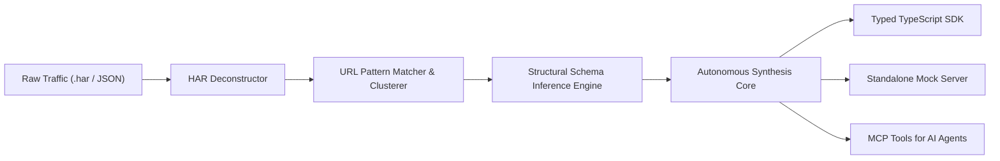

# TEA — Traffic & Protocol Engineering Anything ☕🌐

> **Autonomous Network Stream Deconstruction, Schema Inference, and Typed SDK Synthesis Engine.**

TEA is an agentic, ground-truth protocol engineering tool. It transforms opaque HTTP/WebSocket traffic captures (`.har`, raw JSON logs) into **100% strongly-typed TypeScript SDKs**, **OpenAPI specifications**, and **stateful mock servers** with zero human hallucination.

---

## ⚡ Architecture



---

## 🚀 Key Capabilities

- **Ground-Truth HAR Deconstruction**: Parses HTTP Archive v1.2 files, normalizes query params, headers, and request/response bodies.
- **REST Path Clustering**: Automatically turns `/api/v1/users/8372/orders` and `/api/v1/users/9102/orders` into parameterized route `/api/v1/users/{userId}/orders`.
- **Multi-Observation Schema Unification**: Recursively inspects multiple payloads for the same endpoint to infer optional fields, nullability, enums, and nested records.
- **Zero-Dependency SDK Synthesis**: Emits clean TypeScript classes using native `fetch` with typed method signatures, auth header management, and error handling.
- **Instant Mock Server**: Generates an executable mock server with recorded state responses for offline testing and rapid prototyping.
- **Full MCP Server Included**: Plug TEA directly into Antigravity, Claude Code, Cursor, or Windsurf.

---

## 🛠️ CLI Usage

### 1. Inspect Traffic
```bash
npx tea inspect traffic.har
```

### 2. Infer API Endpoints & Schemas
```bash
npx tea infer traffic.har --format json
```

### 3. Synthesize Strongly-Typed SDK
```bash
npx tea sdk traffic.har --output ./generated-sdk --name AcmeClient
```

### 4. Run MCP Server
```bash
npx tea mcp
```

---

## 🤖 MCP Tools Exposed to AI Agents

| Tool | Description |
|---|---|
| `inspect_network_traffic` | Ingests HAR file or JSON frames and returns structured endpoint inventory. |
| `infer_api_schema` | Generates inferred TypeScript and JSON Schema types across multiple observations. |
| `synthesize_typed_sdk` | Generates clean-room TypeScript client code with typed methods and interfaces. |
| `generate_mock_server` | Produces an executable mock server script matching the recorded traffic. |

---

## 📄 License
Apache-2.0
